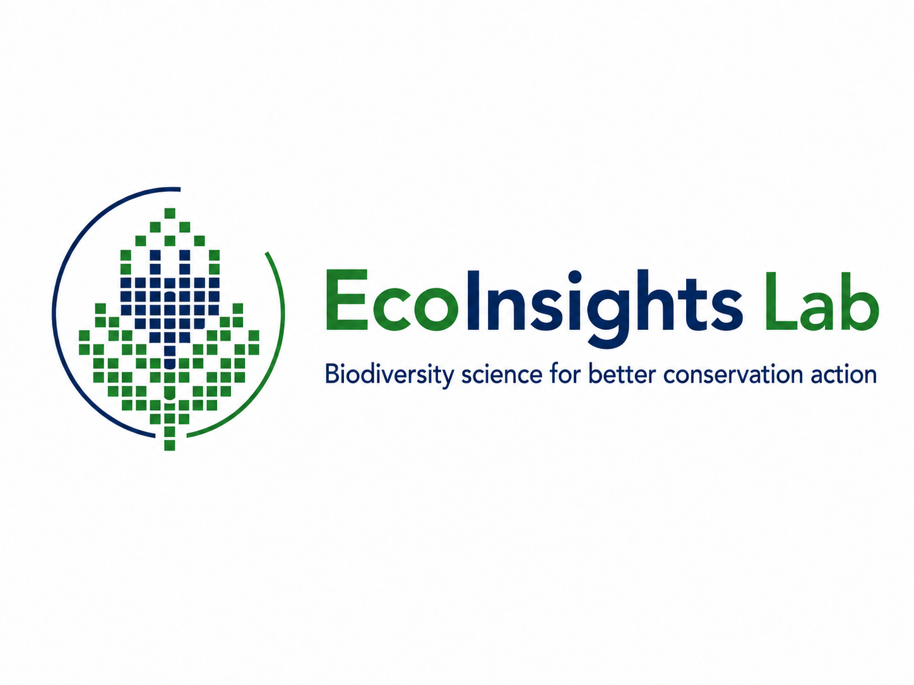

```{=html}
<!-- EDITING: Search for TODO to find every completion item. Keep this file and its
     rendered HTML as drafts until all placeholders have been reviewed. Remove the
     noindex meta tag in the YAML only when preparing the final public version.
     See EDITING_GUIDE.md for sources, checks and instructions. -->
```

::: draft-banner
**Website draft · 23 October 2026.** Highlighted “To complete” boxes identify information or images to add before publication.
:::

::: eyebrow
Statistical ecology · Biodiversity · Environmental change
:::

::: lead
I use ecological data, statistical models and satellite observations to understand how biodiversity and ecosystems respond to environmental change—and to help turn that understanding into conservation and climate-adaptation decisions.
:::

I am a Research Fellow in the **Centre for Statistics in Ecology, the Environment and Conservation (SEEC)**, Department of Statistical Sciences, at the **University of Cape Town**. I am also a research associate of the **People in Nature & Climate (PiNC) Lab** at UCT’s African Climate & Development Initiative (ACDI).

My work connects species distribution modelling, ecosystem-condition assessment, biodiversity data science and nature-based solutions. I collaborate with researchers, conservation agencies and practitioners across southern Africa and internationally.

[Explore my research](#research) · [Selected publications](#publications) · [Study and collaborate](#people) · [Contact me](#contact)

::: {.placeholder .asset-placeholder}
{width=240}
**To complete P01 — EcoInsights logo and identity.** <!-- TODO P01 --> Add the selected block-built protea logo, preferably as an SVG or a transparent PNG. Confirm “EcoInsights Lab” as the public name and add one sentence describing the group’s relationship to SEEC. This draft uses the previously discussed tagline; it does not imply a separate institutional appointment.
:::

::: {.placeholder .asset-placeholder}
**To complete P02 — Portrait or landscape photograph.** <!-- TODO P02 --> Add a recent portrait or a strong field photograph, with a caption, image credit and descriptive alt text. Choose an image that connects you to the landscapes or research featured here.
:::

# Research {#research}

Four themes connect my research. Across them, I aim to make ecological analyses transparent, reproducible and useful to the people making decisions about biodiversity and land management.

::::::: research-grid
::: research-card
### Biodiversity distributions and ecological forecasting

Understanding why species occur where they do, and how their distributions may change as climate, land use and human activities change. My work includes native and alien plants, grass biogeography and species distribution modelling.
:::

::: research-card
### Ecosystem condition and restoration

Assessing changes in ecosystem structure, function and composition using remote sensing, field observations and ecological knowledge. I am particularly interested in distinguishing degradation from natural variability and assessing recovery.
:::

::: research-card
### Climate risk and nature-based solutions

Investigating how climate change affects the species and ecosystems underpinning nature-based solutions, and combining ecological evidence with information about hazards, exposure and vulnerability to inform adaptation.
:::

::: research-card
### Biological invasions

Understanding invasion pathways, species traits and environmental contexts to improve the prediction, prioritisation and management of alien species. Invasive grasses have been a longstanding focus.
:::
:::::::

# Projects and collaborations {#projects}

## SBAPP: mapping and monitoring ecosystem condition {#sbapp}

::: project-meta
**Role:** Co-PI and UCT lead for ecological condition mapping and modelling · **Partners:** SANBI and regional collaborators · **Funding:** AFD and FFEM
:::

Ecosystems can lose biodiversity and ecological functioning even where their broad land-cover category remains unchanged. Assessing these changes requires ecological interpretation alongside remotely sensed observations.

Within the SANBI-led **Spatial Biodiversity Assessment, Planning and Prioritisation (SBAPP)** programme, I lead UCT’s contribution to ecological condition mapping and modelling. The wider regional programme involves South Africa, Namibia, Mozambique and Malawi. Our work brings together spatial data, field observations and expert knowledge to support biodiversity assessment, the Red List of Ecosystems and conservation planning.

We are developing approaches that identify the pressures affecting an ecosystem and select indicators appropriate to its ecological context. Recent work includes vegetation productivity and bare-ground dynamics, condition in dryland and grassy ecosystems, and recovery in previously cultivated landscapes. A developing strand examines how fire-related assessments depend on the ecological reference conditions and observational datasets used.

**Why it matters:** Better condition information can help identify where ecosystems are declining, where restoration may be needed and how change should be monitored.

**Featured output:** [Ecosystem condition assessments: a context-specific workflow to integrate local expert knowledge and remote sensing](https://doi.org/10.32942/X29W9S), listed as a preprint in my August 2026 CV.

::: placeholder
**To complete P03 — SBAPP details and results.** <!-- TODO P03 --> Confirm the programme dates and the current status of the workflow paper; add the official project page, key collaborators and one or two results approved for public release. The CV lists 2023–2027 for this funding entry.
:::

::: {.placeholder .asset-placeholder}
**To complete P04 — Ecosystem-condition figure.** <!-- TODO P04 --> Add a map or a field-to-satellite example. Include the region, period, indicator, data source, interpretation and any important uncertainty. Avoid presenting vegetation greenness alone as a direct measure of condition.
:::

## TES NbS: biodiversity under a changing climate {#tes-nbs}

::: project-meta
**Role:** Work-package lead, as recorded in my CV · **Collaboration:** PiNC Lab / ACDI · **Funding:** IDRC
:::

The **Towards Equitable and Sustainable Nature-based Solutions (TES NbS)** collaboration asks how working with nature can support adaptation while accounting for ecological and social outcomes. My contribution focuses on the biodiversity underpinning these interventions and how it may respond to climate change.

I use species distribution models to examine potential changes in plant assemblages relevant to restoration, agroforestry and tree-based interventions. The analyses consider species that may persist, be lost or gain suitable conditions, as well as the resulting turnover in assemblages. Related scenario work represents alternative land-cover configurations and plant functional types for assessing ecological consequences.

**Why it matters:** Species and interventions that are suitable today may not remain suitable as the climate changes. The work also considers trade-offs where tree planting could replace naturally open ecosystems or introduce invasion risks.

::: placeholder
**To complete P05 — TES NbS status and outputs.** <!-- TODO P05 --> Confirm the funded phase, dates and status of continuing analyses; the CV lists 2021–2023. Add the exact work-package title, project link, collaborators and public outputs. Insert final species counts, warming levels and numerical findings only after reconciling them with the latest analysis.
:::

::: {.placeholder .asset-placeholder}
**To complete P06 — Species-change or scenario figure.** <!-- TODO P06 --> Add a richness, persistence or turnover map, or a comparison of land-cover scenarios. State the baseline, future scenario or warming level, species group and model uncertainty.
:::

## ALBATROSS: climate risk and ecosystem-based adaptation {#albatross}

::: project-meta
**Role:** Work-package lead, as recorded in my CV · **Collaboration:** PiNC Lab / ACDI and the ALBATROSS consortium · **Funding:** EU Horizon
:::

[ALBATROSS](https://albatross-project.eu/) works with local and national actors to support climate adaptation in sub-Saharan Africa. My contribution links biodiversity modelling and ecosystem functions with assessments of climate risk and nature-based adaptation options.

The ecological work examines how the species supporting ecosystem functions and nature-based solutions may change under future climates. A complementary focus is the development of a climate-risk assessment for the **uMzimvubu region in the Eastern Cape**, combining climate hazards with information on exposure and vulnerability.

Recent work has addressed water insecurity associated with rainfall change and drought, damage from severe rainfall, heat-related impacts on agricultural livelihoods, and fire risk. The assessment is intended to make spatial evidence useful to municipal planners, conservation and development organisations, extension services and other local practitioners.

**Why it matters:** Adaptation planning needs information about where risks occur, who or what is exposed, and how ecological interventions could help address those risks.

::: placeholder
**To complete P07 — ALBATROSS scope and delivery.** <!-- TODO P07 --> Confirm the formal work-package/task wording, project dates, hub coverage and which uMzimvubu outputs are ready to share. Add the relevant deliverable or paper links. Describe the risk tool as “in development” until a public version is available.
:::

::: {.placeholder .asset-placeholder}
**To complete P08 — Climate-risk example.** <!-- TODO P08 --> Add a map or screenshot from the uMzimvubu assessment, with an explanation of the risk represented, spatial scale, reference period and limitations. Add a live tool link only when it is public and documented.
:::

## InvaSyn: understanding recurring patterns of invasion {#invasyn}

::: project-meta
**Focus:** Invasion syndromes, synthesis and analysis · **Collaboration:** South African and international research partners
:::

InvaSyn investigates whether recurring combinations of species characteristics, introduction pathways and environmental conditions can improve our understanding and management of biological invasions. These combinations are described as **invasion syndromes**.

My involvement focuses on analytical work using data assembled through the collaboration. A planned output is a structured description of the data categories defining the identified syndromes, together with measures of confidence or uncertainty. This builds on my broader research on invasive plants, especially grasses, and on approaches for turning invasion evidence into management priorities.

The collaboration also provides a basis for postgraduate training and work with the University of Venda and international partners.

**Why it matters:** Identifying recurring patterns could make knowledge transferable across species and places, while making the uncertainty in those generalisations explicit.

::: placeholder
**To complete P09 — InvaSyn project and recruitment details.** <!-- TODO P09 --> Add the official project title and URL, your formal role, funder acknowledgement, dates, work package/task and named collaborators. Confirm the analysis timetable and intended output wording. Add a University of Venda PhD advert only when the position and application arrangements are confirmed.
:::

## Biodiversity data: BIRDIE and Africa Bird Data {#bird-data}

I contribute to collaborations that make biodiversity observations easier to access, analyse and use in conservation. **BIRDIE** connects data processing and indicators to wetland and waterbird conservation, while the **Africa Bird Data packages** provide access to African citizen-science bird data in R.

These collaborations complement my work on ecological indicators and reproducible biodiversity-data workflows. A developing direction is to connect bird-based information more closely with ecosystem-condition assessment.

[BIRDIE paper](https://doi.org/10.3389/fevo.2023.1131120) · [Africa Bird Data paper](https://doi.org/10.2989/00306525.2024.2423652)

::: placeholder
**To complete P10 — Data resources.** <!-- TODO P10 --> Add verified links to the BIRDIE platform and Africa Bird Data documentation, and describe your specific contribution. Confirm the status of any Phase II activities before presenting them as funded or delivered.
:::

# Publications and resources {#publications}

The selection below illustrates my work across ecosystem condition, biodiversity data and invasion science. [View my Google Scholar profile](https://scholar.google.co.za/citations?user=GwJXHYEAAAAJ&hl=en&oi=ao) for a fuller publication record.

## Selected publications

::: publication
**van der Merwe, S., Visser, V., Seymour, C.L., Hoffman, M.T., Moncrieff, G.R., Slingsby, J.A., Steytler, J., Potts, A.J. and Skowno, A.L. (2026).** Ecosystem condition assessments: A context-specific workflow to integrate local expert knowledge and remote sensing. *EcoEvoRxiv*, preprint. [Read the preprint](https://doi.org/10.32942/X29W9S).

A framework for combining ecological knowledge and remote sensing in context-specific assessments. **Status shown here follows the August 2026 CV.**
:::

::: publication
**Seymour, C.L., Seaton, D., Khatieb, S., Letsatsi, N., Skowno, A., Tokura, W., van der Merwe, S., Visser, V. and von Maltitz, G. (2025).** Satellite-derived productivity outputs for land degradation assessment vary with biome and rainfall. *Land Degradation & Development*, 36, 2913–2927. [Read the paper](https://doi.org/10.1002/ldr.5541).

Examines the importance of biome and rainfall context when interpreting satellite productivity indicators.
:::

::: publication
**Cervantes, F., Lee, A.T.K., Henry, D.A.W., Brooks, M., Visser, V., Cloete, A., Job, N. and Altwegg, R. (2024).** The Africa Bird Data packages: African citizen science bird data in R. *Ostrich*, 95(4), 312–320. [Read the paper](https://doi.org/10.2989/00306525.2024.2423652).

Tools supporting access to African citizen-science bird observations through R.
:::

::: publication
**Cervantes, F., Altwegg, R., Strobbe, F., Skowno, A., Visser, V., Brooks, M., Stojanov, Y., Harebottle, D.M. and Job, N. (2023).** BIRDIE: A data pipeline to inform wetland and waterbird conservation at multiple scales. *Frontiers in Ecology and Evolution*, 11, 1131120. [Read the paper](https://doi.org/10.3389/fevo.2023.1131120).

Connects biodiversity-data processing with information for wetland and waterbird conservation.
:::

::: publication
**MacFadyen, S., Allsopp, N., Altwegg, R., et al. (including Visser, V.) (2022).** Drowning in data, thirsty for information and starved for understanding: A biodiversity information hub for cooperative environmental monitoring in South Africa. *Biological Conservation*, 274, 109736. [Read the paper](https://doi.org/10.1016/j.biocon.2022.109736).

Addresses the connection between environmental monitoring data and usable biodiversity information.
:::

::: publication
**Visser, V., Wilson, J.R.U., Canavan, K., Canavan, S., Fish, L., Le Maitre, D., Nänni, I., Mashau, C., O’Connor, T.G., Ivey, P., Kumschick, S. and Richardson, D.M. (2017).** Grasses as invasive plants in South Africa revisited: Patterns, pathways and management. *Bothalia*, 47(2), a2169. [Read the paper](https://doi.org/10.4102/abc.v47i2.2169).

Synthesises evidence on alien grasses and their management in South Africa.
:::

::: placeholder
**To complete P11 — Publication update.** <!-- TODO P11 --> Check for publications and accepted papers since August 2026; update the preprint status and add any public TES NbS, ALBATROSS or InvaSyn outputs. Keep unpublished analyses clearly labelled. Decide whether to retain a selected list or import a complete bibliography.
:::

## Code, datasets and practical resources

I develop reproducible workflows in R for biodiversity-data preparation, spatial analysis, species distribution modelling and ecological indicators. Public resources will be linked here with documentation, version information and the corresponding project or publication.

::: placeholder
**To complete P12 — Resource links.** <!-- TODO P12 --> Add your GitHub profile and selected public repositories, dataset DOIs, teaching materials and reports. For each resource, supply a title, a one-sentence description, a URL, its licence and its current status. Potential entries include SDM workflows, ecological-condition methods and documented climate-risk indicators; these are suggestions, not claims of current public availability.
:::

# People, supervision and teaching {#people}

## Supervision and opportunities

I supervise and co-supervise postgraduate students and postdoctoral researchers working on biodiversity, ecological change and quantitative methods. My supervision connects ecological questions with statistical modelling, spatial analysis, reproducible workflows and interpretation for conservation.

Prospective projects may address species distributions and climate change, ecosystem condition and restoration, invasion ecology, or biodiversity-data methods. Experience in R and an interest in ecological applications are particularly useful.

If you would like to discuss a possible project, email me with a short outline of your interests, your academic background and the degree or opportunity you have in mind.

::: placeholder
**To complete P13 — People and affiliations.** <!-- TODO P13 --> Update the directory below before publication: confirm preferred spellings, degree or role, current/alumni status, project title and co-supervisors. The entries are a working inventory drawn from the existing website and our discussions, not a verified current roster.
:::

::: table-responsive
| Person | Role recorded in source material | Topic or detail to complete |
|:-----------------------|:-----------------------|:-----------------------|
| Stephni van der Merwe | Postdoctoral researcher, UCT / SANBI | Ecosystem-condition assessment; confirm current affiliation and profile link. |
| Wataru Tokura | PhD, UCT | Dryland vegetation change and remote sensing; confirm thesis title and current status. |
| Tshepiso Mafole | PhD, UCT | Grass responses to environmental conditions; confirm preferred spelling, thesis title and status. |
| Curtley Tonkin | PhD listed on existing website | Confirm whether and how to include in the updated directory. |
| Orselth Elengemoke-Tshala | MSc, UCT | Add approved project title and current status. |
| Ntando Masimula | MSc, UCT | Add approved project title and current status. |
| Claire Gomes | MSc, UCT | Confirm preferred spelling, project title and co-supervisors. |
| Kagiso Mogajane | MSc, from recent discussions | Renosterveld recovery and previously cultivated fields; confirm title and affiliations. |
| Boyd Zyambo | MSc, from recent discussions | Mapping *Androstachys* using historical imagery; confirm title and affiliations. |
:::

**Alumni and former researchers listed on the existing website:** Marileen van der Westhuizen; Keletso Moilwe; Craig Mahlasi; Jarryd Foster; Tim Kirsten; Emma Wright; Wesley Bell; Suresh Babu; Thinabakho Ncube; Khensani Nkuna; Reetumetse Tlhakung; Vhonani Tsanwani; and Sarah Casola. Their degree or appointment dates and project links should be checked when the directory is updated.

::: placeholder
**To complete P14 — Advertised opportunities.** <!-- TODO P14 --> Add confirmed MSc, PhD or postdoctoral opportunities, with eligibility, funding, deadline and application link. Possible entries to verify include the spatial biodiversity-planning PhD, SBAPP-related MSc topics and the InvaSyn / University of Venda opportunity. Remove this box if no positions are currently advertised.
:::

## Teaching and training

I teach quantitative approaches that help students move from ecological questions to defensible analyses and clear communication. My teaching includes undergraduate and postgraduate statistics and R-based data analysis at UCT, SEEC short courses, species distribution modelling, and GIS.

I have designed and delivered professional training in R, biodiversity-data management, species distribution modelling and ecological statistics through SANBI, SEEC and partner institutions. My August 2026 CV records training delivered to more than 200 early-career scientists. Earlier teaching includes Honours GIS at Stellenbosch University and a third-year Ecological Entomology module at the University of Derby.

::: placeholder
**To complete P15 — Teaching resources.** <!-- TODO P15 --> Add current course titles, your teaching role, upcoming course dates where relevant, and links to materials that can be shared publicly. Update or remove the dated training total if a more useful current description is available.
:::

# About and experience {#about}

My interest in ecology grew from a fascination with maps and the natural world. Research has allowed me to combine these interests: asking why species occur where they do, how ecosystems change, and how we can detect and anticipate those changes.

I trained in botany and ecology at the University of Cape Town and completed a PhD in Ecology at the University of Sheffield in 2010. My doctoral research examined environmental and evolutionary determinants of C4 grass diversity in South Africa. Subsequent work at Sheffield and the Centre for Invasion Biology at Stellenbosch University developed these interests in grass biogeography, ecological data and biological invasions.

Since 2015, I have been a Research Fellow at SEEC. My work increasingly connects ecological research with biodiversity assessment, monitoring, conservation planning and climate adaptation. I serve on the SEEC Leadership Team as Head of Funding and contribute to collaborative programme development, research delivery and postgraduate mentorship.

## Experience at a glance

| Period | Appointment |
|:-----------------------------------|:-----------------------------------|
| 2015–present | Research Fellow, SEEC, Department of Statistical Sciences, University of Cape Town |
| 2011–2015 | Postdoctoral researcher, Centre for Invasion Biology, Stellenbosch University |
| 2009–2011 | Postdoctoral researcher, Animal & Plant Sciences, University of Sheffield |
| 2009 | Guest lecturer, University of Derby |

## Methods and applied work

My technical work spans R-based data analysis, species distribution modelling, ecological forecasting, regression and mixed models, multivariate analysis, time-series remote sensing and spatial data workflows. I work with QGIS, ArcGIS and Google Earth Engine alongside reproducible R and GitHub workflows.

I have worked with SANBI, SANParks, CapeNature and other conservation partners, and provided ecological modelling, analysis or training expertise to organisations including EPPO and IUCN. This includes pest-risk analyses and technical contributions to invasive-species assessment. I also established and coordinated the SANBI-supported Alien Grass Working Group.

::: placeholder
**To complete P16 — Public CV and professional links.** <!-- TODO P16 --> Add a web-ready CV PDF, ORCID and GitHub links. The supplied SANBI CV is the source for this section; prepare a public version without referee contacts before linking it. Verify undergraduate degree dates if adding a detailed education timeline.
:::

# Developing directions {#directions}

These topics describe interests and work in development; the scope and public outputs will evolve as collaborations progress.

## Does spatial biodiversity planning prevent habitat loss?

I am interested in evaluating the effectiveness of Critical Biodiversity Areas and Ecological Support Areas, accounting for differences in underlying development pressure. This work connects remote sensing, biodiversity planning and the role of ecological processes in climate adaptation.

## Historical baselines for environmental change

Historical photographs, aerial imagery and maps can extend our understanding of landscape change beyond the satellite record. I am exploring ways to combine these sources with community knowledge and spatial analysis to study habitat transformation, alien trees and urban expansion, including around Cape Town.

## Birds as indicators of ecosystem condition

A further interest is linking biodiversity observations and bird indicators with the ecosystem-condition frameworks developed through SBAPP and related research.

::: placeholder
**To complete P17 — Scope and status of developing work.** <!-- TODO P17 --> Decide which directions to include now. For each, specify whether it is an idea, an awarded studentship, active research or a funding proposal, and add collaborators or public links where appropriate. Avoid implying that all three are funded programmes.
:::

# Contact and collaboration {#contact}

I welcome enquiries about research collaboration, postgraduate supervision and training in ecological modelling, biodiversity data and spatial analysis.

**Email:** [vernon.visser\@uct.ac.za](mailto:vernon.visser@uct.ac.za)\
**Institution:** Centre for Statistics in Ecology, the Environment and Conservation (SEEC), Department of Statistical Sciences, University of Cape Town, South Africa\
**Research network:** [PiNC Lab](https://www.pinclab.co.za/team), African Climate & Development Initiative\
**Publications:** [Google Scholar](https://scholar.google.co.za/citations?user=GwJXHYEAAAAJ&hl=en&oi=ao)

::: placeholder
**To complete P18 — Final contact and branding details.** <!-- TODO P18 --> Add the preferred SEEC profile URL and future website domain. Add institutional, partner or funder logos with appropriate acknowledgements. Confirm whether to include an office location, additional professional profiles or a separate EcoInsights contact address.
:::

::: footer-note
Vernon Visser · EcoInsights Lab · Biodiversity science for better conservation action\
Draft content prepared 23 October 2026. Update the date when the public version is reviewed.
:::
